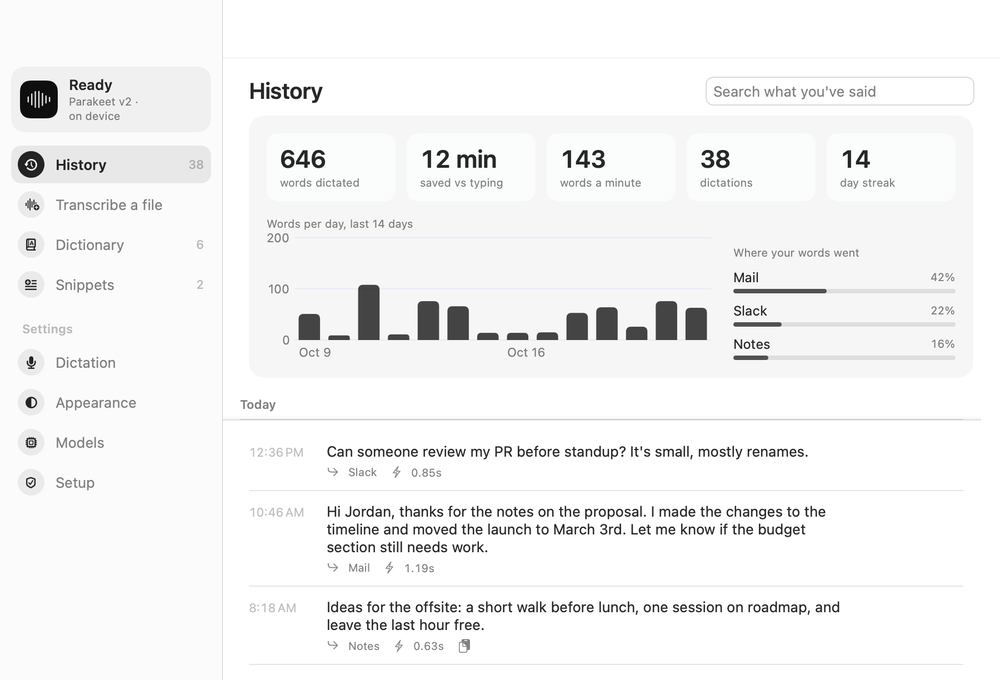
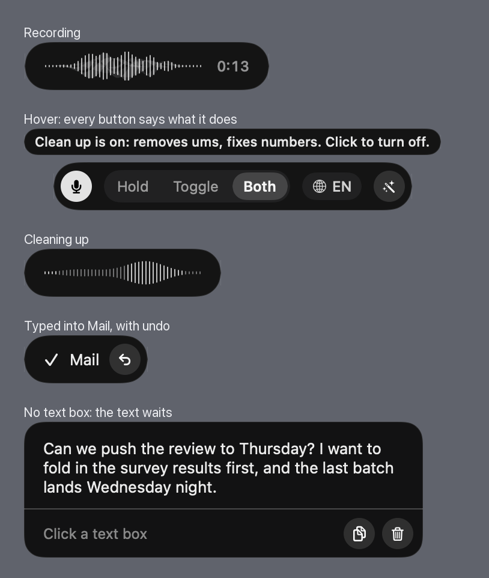
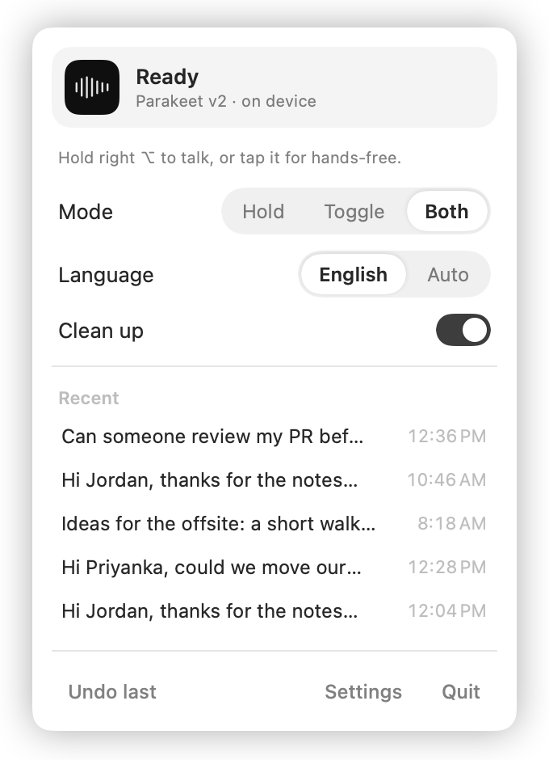
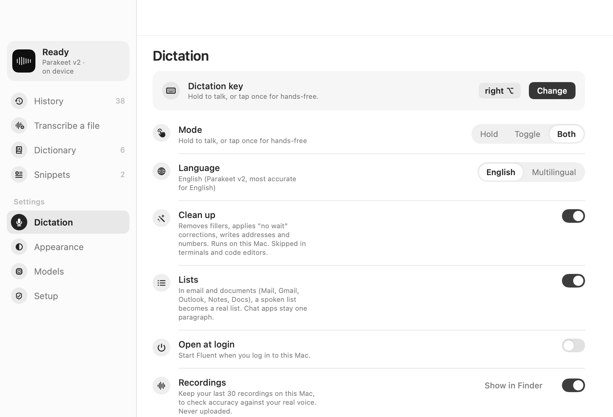
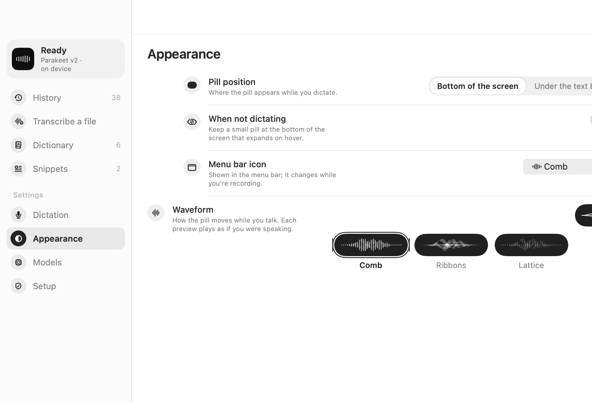
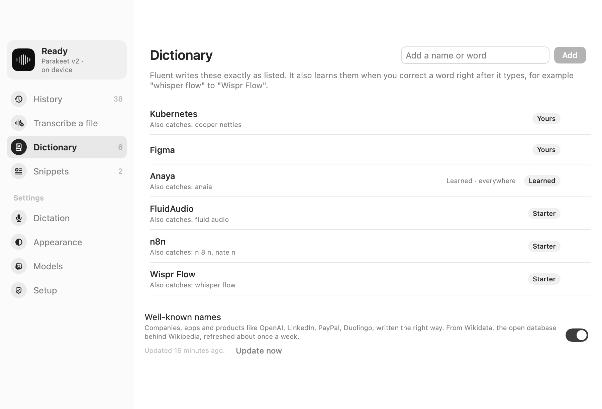
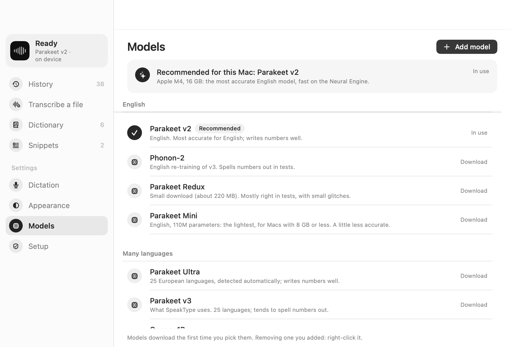
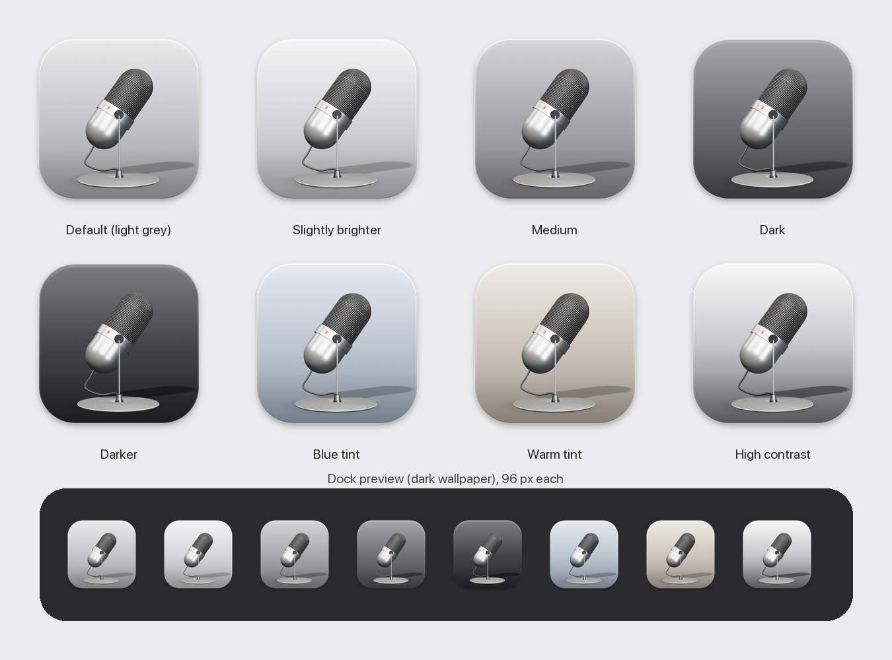

# Fluent

Dictation for the Mac that runs on your Mac. Hold a key, talk, let go, and the text lands in whatever box you were typing in. No account, no subscription, and your voice never leaves the computer.

<picture>
  <source media="(prefers-color-scheme: dark)" srcset="docs/screenshots/history-dark.png">
  
</picture>



## What it does

- **Types where you are.** Text goes straight into the focused text box, in native apps and in browsers (Chrome, Arc, Safari, Electron apps). If an app refuses direct typing, Fluent pastes instead and puts your clipboard back afterwards, marked so clipboard managers skip it.
- **Waits when there's nowhere to type.** Stop talking with no text box selected and the text waits in the pill. Click into a box and press Return to drop it in.
- **Hold or tap.** One key does both: hold it to talk, or tap it once for hands-free and tap again to stop. Right Option by default; any key can be picked.
- **Follows you across screens.** The pill appears on the screen of the box you're typing in.
- **Cleans up, without changing what you meant.** Removes ums and false starts, applies "no wait, five" corrections, writes numbers, times, temperatures, phone numbers and addresses as digits. Runs on Apple's on-device model (Apple Intelligence), and checks every result: if the cleanup changed a word, a number or a meaning, Fluent types what you said instead.
- **Learns your words.** A dictionary of names written your way, plus the ones it learns when you correct a word right after it types. Well-known company and product names (PayPal, eBay, SpaceX, Duolingo) come from Wikidata, refreshed about once a week.
- **Snippets.** Say "my email" and get your address, or give a snippet its own shortcut.
- **Shapes text for the app.** In email and documents, a spoken list becomes a real list; in chat it stays one paragraph.
- **Transcribes files.** Drop in a voice memo, meeting recording or podcast (m4a, mp3, wav, mp4, mov) and get the text.
- **History and a small dashboard.** Words dictated, time saved against typing, your pace, and where your words went.

## A look around

The menu bar panel and the settings, in the same black-and-white style as the pill.

<table>
<tr>
<td width="34%" valign="top"><picture>
  <source media="(prefers-color-scheme: dark)" srcset="docs/screenshots/menu-dark.png">
  
</picture></td>
<td valign="top"><picture>
  <source media="(prefers-color-scheme: dark)" srcset="docs/screenshots/dictation-dark.png">
  
</picture></td>
</tr>
</table>

<picture>
  <source media="(prefers-color-scheme: dark)" srcset="docs/screenshots/appearance-dark.png">
  
</picture>

<picture>
  <source media="(prefers-color-scheme: dark)" srcset="docs/screenshots/dictionary-dark.png">
  
</picture>

## Speech models

All run on the Mac through [FluidAudio](https://github.com/FluidInference/FluidAudio) (Core ML, on the Neural Engine), except Apple's, which is built into macOS. Fluent recommends one for your Mac from its chip, memory and first language.

| Model | Languages | Notes |
|---|---|---|
| Parakeet v2 (NVIDIA) | English | Most accurate for English, writes numbers well. The default. |
| Parakeet Mini (NVIDIA) | English | 110M parameters, for Macs with 8 GB or less. |
| Parakeet Ultra (NVIDIA) | 25 European languages | Detects the language by itself. |
| Parakeet v3, Phonon-2, Redux | 25 European languages / English | Other versions of the same family. |
| Canary 1B (NVIDIA) | 25 European languages | Accurate but slow; best for transcribing files. |
| Parakeet Japanese (NVIDIA) | Japanese | |
| SenseVoice Small (Alibaba) | Chinese, Cantonese, Japanese, Korean | Very fast. |
| Apple on-device | Your Mac's language | macOS 26 and later; nothing to download. |
| Your own server | Anything | Any server that speaks the OpenAI transcription API. |

Models download the first time you pick them (a few hundred MB each).

<picture>
  <source media="(prefers-color-scheme: dark)" srcset="docs/screenshots/models-dark.png">
  
</picture>

<p align="center"></p>

## Build it

You need an Apple Silicon Mac on macOS 15 or later, Xcode, and [XcodeGen](https://github.com/yonaskolb/XcodeGen) (`brew install xcodegen`).

```bash
scripts/build.sh
open build/Fluent.app
```

Then grant the three permissions the setup screen asks for: Microphone, Accessibility (to type into other apps) and Input Monitoring (for the dictation key).

The build is signed ad-hoc, so macOS asks for the permissions again after each rebuild. To keep them, sign with your own free Apple developer certificate: `FLUENT_TEAM=<your team id> scripts/build.sh`. With no provisioning profile, nothing expires.

Cleanup needs Apple Intelligence switched on (System Settings, Apple Intelligence & Siri). Without it, Fluent still removes fillers and writes numbers by rule.

## Privacy

- Audio is transcribed on your Mac and never uploaded (unless you add your own server).
- Nothing is collected and there is no analytics.
- Two things use the network: downloading a model the first time you pick it (from Hugging Face), and the weekly fetch of well-known names from Wikidata, which sends only the query.
- History, your dictionary and snippets live in `~/Library/Application Support/Fluent/`. Keeping your last 30 recordings (to check accuracy) is optional.

## Credits

Speech models by NVIDIA (Parakeet, Canary) and Alibaba (SenseVoice), converted and run by [FluidAudio](https://github.com/FluidInference/FluidAudio) (Apache 2.0). Well-known names from [Wikidata](https://www.wikidata.org) (CC0).

## License

MIT. See [LICENSE](LICENSE).
